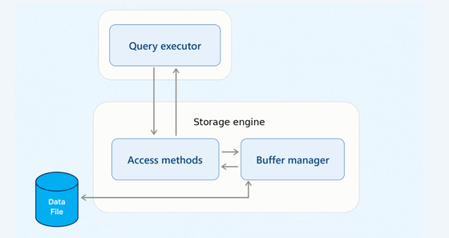
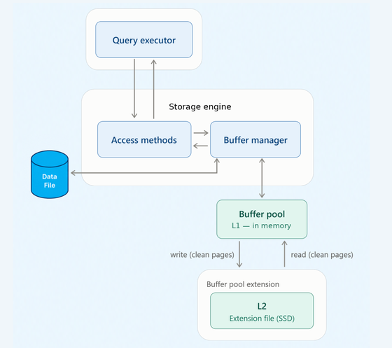
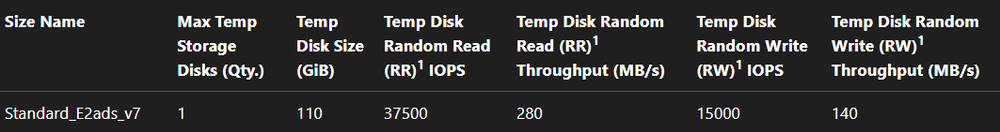

Memory keeps getting more expensive, so we need to make the most of what we have. That's why I want to talk about a feature that isn't very well known (and I wonder why), the Buffer Pool Extension.

The scenario is a classic one: a VM whose working set doesn't fit in the buffer pool, so queries keep going back to disk. The usual first answer is "add more RAM", which on a cloud VM means a bigger size and a bigger bill. Because cloud VM sizes usually step up in fixed tiers, getting more memory can mean nearly doubling the VM, along with its cost.

Buffer Pool Extension (BPE) has been around since SQL Server 2014, and it's available on Standard edition too. It doesn't replace memory, and it isn't a universal fix for performance problems. But in the right scenario, it can make a real difference for reads.

The goal of this post isn't to teach how to configure BPE. The documentation and plenty of other posts already cover that. Here, I want to show how it works, when it helps and when it doesn't.

## Table of contents

## The buffer pool in one minute

When SQL Server reads a data or index page, it brings the page into memory, into the buffer pool. While there's room, the page stays there, and the next query that needs it doesn't have to go to disk. When memory runs out, SQL Server has to evict pages to make room for new ones.

In a simplified view, a query doesn't read the data file directly. The query executor asks the storage engine for the data, the access methods ask the buffer manager for each page, and the buffer manager either finds the page in the buffer pool or reads it from the data file:



Before evicting a page from memory, SQL Server looks at its state:

- **Clean page:** its content is the same as the copy in the data file. It can simply be dropped from memory.
- **Dirty page:** it was changed in memory and that change hasn't been written to the data file yet. It has to be written before it can be evicted.

Keep this difference in mind.

## What is Buffer Pool Extension?

Buffer Pool Extension adds a second level of cache to the buffer pool, using a file on an SSD:

- **L1:** the traditional buffer pool, in memory (DRAM).
- **L2:** the buffer pool extension, a file on SSD.



According to the documentation, only clean pages are written to the L2 cache, and the buffer manager handles the movement of these pages between L1 and L2. When a clean page is evicted from memory, it can go to the BPE file. If a query needs it again, SQL Server can read it from the BPE instead of the data file.

It's just as important to understand what BPE is not:

- It isn't more RAM. Reading from an SSD is still much slower than reading from memory.
- It doesn't replace the buffer pool. It extends it.
- It isn't a data file or a log file. Nothing in it is needed to recover the database.
- It doesn't persist dirty pages. Those still go to the data file, as always.
- It doesn't eliminate I/O. It moves part of the reads from the main storage to the cache SSD.

## The setup

The test ran on this environment:

| Component | Value |
| --- | --- |
| Azure VM | `Standard_E2ads_v7` (2 vCPUs, 16 GiB of memory) |
| Operating system | Windows Server 2022 |
| Database | SQL Server 2022 Standard |
| Data disk | Azure Premium SSD v2 (drive `F:`), 3,000 IOPS and 125 MB/s |
| BPE file | Local temporary disk (drive `D:`) |

The interesting part is where the BPE file lives. This VM size comes with a local NVMe temporary disk:



Side by side with the data disk:

| Disk | IOPS | Read throughput |
| :---: | :---: | :---: |
| Data disk (Premium SSD v2, `F:`) | 3,000 | 125 MB/s |
| Temporary disk (local NVMe, `D:`) | 37,500 | 280 MB/s |

The temporary disk has more than twelve times the IOPS and more than twice the throughput of our data disk. That's the kind of gap that makes BPE worth testing.

This temporary disk is ephemeral: its content can be lost when the VM is deallocated or moved to another host. That's why, in general, it's used for tempdb, a database that SQL Server recreates every time it starts. Keep that in mind, because we'll come back to it.

## Running the test

The test is a simple aggregation over a table of about 10 GiB, a scan that reads the whole table:

```sql
SELECT SUM(SalesAmount) AS SalesAmount_sum FROM dbo.FactResellerSalesXL_BIG;
```

For each scenario, I set the buffer pool size with `max server memory`, enabled or disabled the BPE, and ran the query three times. The first execution starts with an empty cache, and the second and third ones show how much of the table the cache was able to keep.

## The results

| Buffer pool | BPE | 1st run | 2nd run | 3rd run | Note |
| :---: | :---: | :---: | :---: | :---: | :---: |
| 14 GiB | OFF | 1min20 | 3s | 3s | Cache doing its job |
| 2 GiB | OFF | 1min20 | 1min20 | 1min20 | Cache too small |
| 2 GiB | 16 GiB | 1min58 | 52s | 38s | Slower first run |
| 14 GiB | 56 GiB | 1min20 | 3s | 3s | BPE wasn't used |

## Understanding the results

**14 GiB, BPE off.** The table fits in the buffer pool. The first execution reads it from disk, and the second and third ones find every page in memory: 3 seconds.

**2 GiB, BPE off.** The table is five times bigger than the buffer pool. While the scan reads the end of the table, it evicts the pages it read at the beginning. When the second execution starts, those pages are no longer in memory, and the whole table comes from disk again: 1min20, the same as the first execution. The third execution is no different. Without BPE, the result can only repeat: either the pages are already in memory, or they're read from disk again.

That 1min20 isn't a coincidence. The scan reads large blocks, so the limit is the disk's throughput, not its IOPS (as we saw in my [previous post about disks](/posts/your-disk-is-provisioned-wrong/), it all depends on the I/O size). A quick calculation: Azure measures throughput in decimal MB (1 MB = 1,000,000 bytes), so 10 GiB is about 10,737 MB. 10,737 MB ÷ 125 MB/s ≈ 86 seconds, in the same range as the 80 seconds we measured. The scan runs as fast as the data disk allows.

**2 GiB, BPE of 16 GiB.** Now the interesting scenario. Same 2 GiB of memory, and the second execution dropped from 1min20 to 52 seconds, about 35% faster. The third one dropped to 38 seconds, about 52% faster.

Pages evicted from memory didn't just disappear. They went to the BPE file on the temporary disk, and in the second execution SQL Server could read them from there instead of going back to the data disk.

Here's what `sys.dm_os_buffer_descriptors` showed for the test database after each execution:

| After | Pages in memory (L1) | Pages in the BPE (L2) |
| :---: | :---: | :---: |
| 1st execution | 204,276 (1,596 MiB) | 1,096,032 (8,563 MiB) |
| 2nd execution | 41,298 (323 MiB) | 1,231,239 (9,619 MiB) |

After the first execution, the whole table, about 10 GiB, was in cache: around 1.6 GiB in memory and 8.4 GiB in the BPE. That's the proof that the pages went to the BPE.

So why 52 seconds and not 3 in the second execution? First, because the BPE doesn't move the data all at once. Pages only go to the BPE when they're evicted from memory. After the first execution, about 1.6 GiB of the table was still only in memory. With a 2 GiB buffer pool, those pages had to make room for the rest of the table during the second execution, so they were written to the BPE for the first time. That's why the BPE grew from 8.4 GiB to 9.4 GiB. The second execution read almost the whole table from the BPE while still writing to it. By the third execution, practically everything was already there.

Second, because an SSD isn't memory. Using the same calculation, reading 10,737 MB at the temporary disk's 280 MB/s takes at least 38 seconds. That's a calculation, not a measurement, but it explains why the gain has a limit.

And the numbers agree. In the third execution, with practically all the pages already in the BPE, the time dropped to 38 seconds, practically that 38-second limit.

There's also a price: the first execution got slower, from 1min20 to 1min58, almost 50% more. During that execution, besides reading from the data disk, SQL Server is writing every evicted page to the BPE file. BPE isn't free.

In other words, a cold cache hurts much more when the BPE is enabled. Whenever the cache starts empty, after a restart for example, the first queries pay twice: they read from the data disk and, at the same time, write to the BPE. Keep that in mind after a maintenance window or a failover.

That's also why it makes no sense to put the BPE on a disk that is slower than your data disk, or one that isn't much faster. Every page that goes through the BPE costs a write and, later, a read. If the BPE disk doesn't have a clear advantage, that extra work isn't worth it, and reading the page from the data file again is just as good.

**14 GiB, BPE of 56 GiB.** Same result as without BPE, in every execution. The table fits in the buffer pool, so no page had to be evicted, and nothing went to the BPE. BPE only works when there's pressure on the buffer pool. If the working set already fits in memory, it doesn't add anything.

Notice that the times alone don't prove where each page came from. They show the effect, not the cause. The DMV numbers above are what prove the BPE was really used, and the next section shows how to check it in your environment.

## Is the BPE really being used?

Having the BPE enabled doesn't mean your queries are benefiting from it. Here's how to check.

**Configuration.** `sys.dm_os_buffer_pool_extension_configuration` shows the file, its state and its size. Configured isn't the same as used, though.

**Pages in the BPE.** `sys.dm_os_buffer_descriptors` has the `is_in_bpool_extension` column, so we can count how many pages of each database are in L1 and in L2. That's where the numbers in the results section came from.

**PerfMon.** The `SQL Server:Buffer Manager` object has counters for the BPE. In my opinion, the most useful ones are:

- `Extension page reads/sec`: pages read from the BPE file. This is the BPE doing its job.
- `Extension pages writes/sec`: pages evicted from memory and written to the BPE file.
- `Extension page evictions/sec`: pages evicted from the BPE file itself.
- `Extension in use as percentage`: how much of the file is in use.
- `Extension page unreferenced time`: how long, on average, a page stays in the BPE without being used.

**Extended Events.** For a more detailed view of the movement between L1 and L2:

- `buffer_pool_extension_pages_written`: pages evicted from memory (L1) and written to the BPE file (L2).
- `buffer_pool_extension_pages_read`: pages read from the BPE file (L2) into memory (L1).
- `buffer_pool_extension_pages_evicted`: pages evicted from the BPE file.
- `buffer_pool_eviction_thresholds_recalculated`: the eviction thresholds were recalculated.

In our 14 GiB scenario, for example, these counters would stay at zero: the BPE is enabled, but not used.

## How big should the BPE be?

The documentation sets limits for SQL Server 2022:

- **Minimum:** larger than the smaller of physical memory and `max server memory`.
- **Maximum, Standard edition on a virtual machine:** 16 times the physical memory.
- **Maximum, Standard edition on a physical machine:** 4 times the physical memory, up to 512 GiB.
- **Maximum, Enterprise and Developer editions:** 32 times the physical memory.

Microsoft also recommends a ratio between physical memory and BPE of 1:16 or less, and says a ratio between 1:4 and 1:8 might be optimal.

Let's take an example: a machine with 128 GiB of memory, leaving about 10% to the operating system. `max server memory` would be around 115 GiB, so the BPE needs to be larger than that. The 1:4 to 1:8 ratio, applied to 128 GiB of physical memory, gives 512 GiB to 1 TiB.

But these are limits, not targets. Local SSDs usually aren't that big, and, as we saw, they're often already used for tempdb. In practice, I'd size it like this:

1. Reserve what tempdb needs on the local disk first.
2. Size the BPE to cover the part of the working set that doesn't fit in the buffer pool.
3. Check that what's left is still larger than `max server memory`. If it isn't, the BPE won't even be enabled.

Sharing the local disk also has a performance cost. tempdb and the BPE will compete for the same IOPS and throughput. If your tempdb usage is high, that competition can hurt both, and you need to evaluate whether putting them together is worth it. If tempdb isn't used that much, it may make more sense to leave the local disk just for the BPE, or to share it without much concern. Either way, measure before you decide.

## What if the BPE disk disappears?

On a cloud VM, using the temporary disk for BPE is the simple path, because the cloud provider gives you that disk ready to use. But it's ephemeral and has no redundancy. If the physical host fails, the disk can crash or simply disappear. On premises, putting the BPE on a single high performance SSD without redundancy, or one less reliable than the other disks in your server, is basically the same scenario. And, in theory, that's acceptable. The documentation explains why: only clean pages are written to the L2 cache, which helps maintain data safety. Every page in the BPE file also exists in the data file, so if the file is lost, no data is lost with it.

I wanted to see that in practice. With the queries running, I took the disk with the BPE file offline. SQL Server didn't crash. The queries kept running and started reading the pages from the data file.

The error log tells the story, from oldest to newest:

```text
A read of the file 'F:\SQLData\DB_TESTE.mdf' at offset 0x0000003e75e000 succeeded after failing 1 time(s) with error: 21(The device is not ready.). Additional messages in the SQL Server error log and operating system error log may provide more detail. This error condition threatens database integrity and must be corrected. Complete a full database consistency check (DBCC CHECKDB). This error can be caused by many factors; for more information, see SQL Server Books Online.

L2 buffer pool read error. BUF address 000002A4DD862640. Bufno 1060110336. Extension offset 417792. Error code 21. Database file id 1840302464. Database file offset 1060110336.

Error: 17053, Severity: 16, State: 1.
The attempt to flush file buffers failed during file close activity.: Operating system error (null) encountered.

Buffer pool extension has been disabled successfully. Deleting buffer pool extension "D:\BPE_FILE.BPE".
```

The first message is the one that catches the eye: a read of `F:\SQLData\DB_TESTE.mdf` failed with error 21, "the device is not ready", followed by a recommendation to run `DBCC CHECKDB`. That's [error 825](https://learn.microsoft.com/en-us/sql/relational-databases/errors-events/mssqlserver-825-database-engine-error), and it should never be ignored. According to the documentation, it means the read had to be reissued, and it points to a problem with the disk hardware. In this case, though, the `F:` drive never went offline. The next message, "L2 buffer pool read error" with the same error 21, shows that the read that failed was from the BPE file. The page belongs to the `.mdf`, so that's the file the 825 names. The retry read the page from the data file, and it succeeded. Then SQL Server couldn't close the BPE file (error 17053) and disabled the BPE on its own.

Even though the error recommends `DBCC CHECKDB`, the BPE has no dirty pages. Everything in it is a copy of what's already in the data file, so losing the BPE doesn't change anything that was persisted. A corruption scenario is much more unlikely than the log makes it look. Running `DBCC CHECKDB` afterwards is still a good practice to confirm, but the expected result is a clean database.

What does change is performance. From that point on, the buffer pool is back to its original size, without the extension. The documentation itself warns that disabling the BPE can hurt performance, because the cache is suddenly much smaller.

## Limitations and considerations

- **Windows only.** BPE is a SQL Server on Windows feature.
- **It isn't on every edition, but at least it works on Standard.** The limits change by edition and by physical or virtual machine, so check the limits for your version.
- **Configured at startup.** The file is a contiguous extent on the SSD, statically configured when the instance starts. Microsoft recommends restarting the instance after you enable it for the first time.
- **Changes require turning it off.** To change the size or path, the BPE must be disabled, and disabling it in production shrinks the cache at once.
- **Writes have a cost.** Every page evicted from memory can become a write to the cache SSD. Look at the SSD's endurance, latency, IOPS and throughput, not only its size.
- **It won't help when:** the working set already fits in memory, pages are rarely reused, the workload is mostly writes, or the cache SSD isn't much faster than the main storage.
- **Look at the basics first.** Better indexes, compression or columnstore reduce how much data a query needs to read. And sometimes, more memory is simply the right answer.

## Conclusion

Buffer Pool Extension is a niche tool. It can help when the buffer pool is under pressure, the working set is larger than the available memory, pages are reused, and there's a real performance gap between the cache SSD and the main storage. In our test, with the same 2 GiB of memory, a query that took 1min20 ran in 52 seconds on the second execution and in 38 seconds from the third on, at the cost of a slower first execution.

In the end, the question is simple: when a page isn't in memory, would you rather read it from a disk with 3,000 IOPS and 125 MB/s, or from one with 37,500 IOPS and 280 MB/s? That's why BPE can be worth it. It doesn't make the SSD as fast as memory, but it lets SQL Server go to the faster disk instead of the slower one.

It isn't a replacement for memory, and it shouldn't be the first answer to an I/O problem. But in times when memory keeps getting more expensive, it's worth knowing it exists. And, as always: test it with your workload before you take it to production.

## References

- [Buffer Pool Extension](https://learn.microsoft.com/en-us/sql/database-engine/configure-windows/buffer-pool-extension)
- [ALTER SERVER CONFIGURATION](https://learn.microsoft.com/en-us/sql/t-sql/statements/alter-server-configuration-transact-sql)
- [sys.dm_os_buffer_pool_extension_configuration](https://learn.microsoft.com/en-us/sql/relational-databases/system-dynamic-management-views/sys-dm-os-buffer-pool-extension-configuration-transact-sql)
- [sys.dm_os_buffer_descriptors](https://learn.microsoft.com/en-us/sql/relational-databases/system-dynamic-management-views/sys-dm-os-buffer-descriptors-transact-sql)
- [MSSQLSERVER_825](https://learn.microsoft.com/en-us/sql/relational-databases/errors-events/mssqlserver-825-database-engine-error)
- [SQL Server, Buffer Manager object](https://learn.microsoft.com/en-us/sql/relational-databases/performance-monitor/sql-server-buffer-manager-object)
- [Eadsv7 series sizes](https://learn.microsoft.com/en-us/azure/virtual-machines/sizes/memory-optimized/eadsv7-series)
