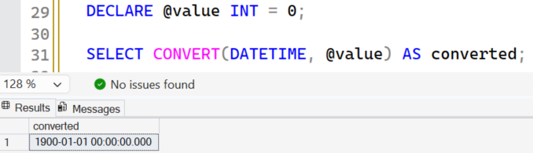
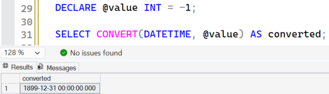
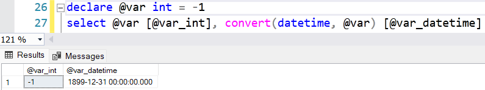
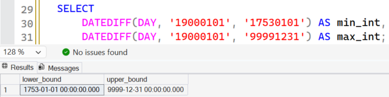
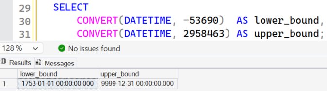
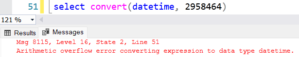

You'd expect converting an arbitrary string to `DATETIME` to fail with a conversion error. But why does it work with `INT` values? Or rather, why does it only work for a certain range of values?

## Table of contents

## The DATETIME range

According to Microsoft's documentation for the `DATETIME` data type, this is its range of values:


In other words, a `DATETIME` column can only store dates between January 1, 1753 and December 31, 9999. Any attempt to set a value outside that range results in an error.

## The default value

The documentation also tells us that the default value for `DATETIME` is January 1, 1900:


> [!NOTE]
> This does not mean that a `DATETIME` variable declared without a value automatically gets this date. It will be `NULL`.
>
> The default value is used when an operation doesn't specify a date, for example in explicit or implicit conversions.

## Converting INT to DATETIME

The information above helps us understand how `DATETIME` works, but how does it answer the original question?

If we declare an `INT` variable with the value `0` and convert it to `DATETIME`, we get this:



SQL Server automatically converted `0` to the default value mentioned above.

Now with the value `1`, SQL Server returns January 2, 1900:



What's happening is that when you convert an integer to `DATETIME`, SQL Server adds that number as days to the default value `1900-01-01`:

- With `0`, it added 0 days to the default value.
- With `1`, it added 1 day and returned 1900-01-02.

The same thing happens with negative integers, except now the days are subtracted. Setting `-1` returns 1899-12-31:



## The range of valid integers

So integers are added as days to the default value. Does that work for any integer?

As we saw earlier, `DATETIME` only accepts values between 1753-01-01 and 9999-12-31. So the only integers that can be converted are the ones whose number of days, added to or subtracted from the default value, still lands inside that range.

Knowing that, we can calculate the number of days between 1753-01-01 and the default value, and between the default value and 9999-12-31:

```sql
SELECT
    DATEDIFF(DAY, '19000101', '17530101') AS min_int,
    DATEDIFF(DAY, '19000101', '99991231') AS max_int;
```

The smallest possible value is -53690 and the largest is 2958463:



Converting those results back to `DATETIME` returns, as expected, exactly the boundaries of the type:

```sql
SELECT
    CONVERT(DATETIME, -53690)  AS lower_bound,
    CONVERT(DATETIME, 2958463) AS upper_bound;
```



| Integer   | Resulting DATETIME        |
| --------- | ------------------------- |
| `-53690`  | `1753-01-01 00:00:00.000` |
| `-1`      | `1899-12-31 00:00:00.000` |
| `0`       | `1900-01-01 00:00:00.000` |
| `1`       | `1900-01-02 00:00:00.000` |
| `2958463` | `9999-12-31 00:00:00.000` |

## Integers out of range

Only values between -53690 and 2958463 can be converted to `DATETIME`, because they represent the limits of the data type.

This is the error you get when you try to convert an integer outside that range:

```sql
SELECT CONVERT(DATETIME, 2958464);
```

```text
Msg 8115, Level 16, State 2
Arithmetic overflow error converting expression to data type datetime.
```



In theory, `2958464` would represent January 1 of the year 10000. But since it goes past the upper limit of `DATETIME`, the conversion fails with an overflow error. The same happens with `-53691` or any other integer outside the range.

## Conclusion

The initial questions look simple, but they help us understand how `DATETIME` works and how integers are converted to dates.

The idea for this post came from a real case: I had to figure out why a conversion error suddenly started happening "out of nowhere" in a production environment.

Knowing how the data types work was one of the things that let me act quickly and pinpoint the problem. This kind of fundamental understanding can be crucial when solving complex issues in critical environments.

## References

- [datetime (Transact-SQL) – Microsoft Learn](https://learn.microsoft.com/en-us/sql/t-sql/data-types/datetime-transact-sql)
