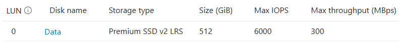
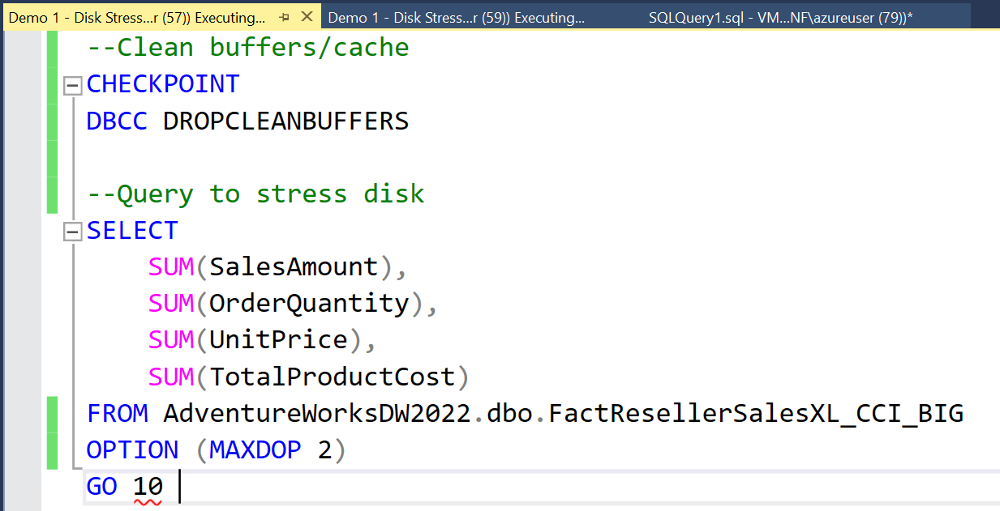
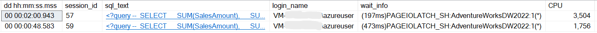
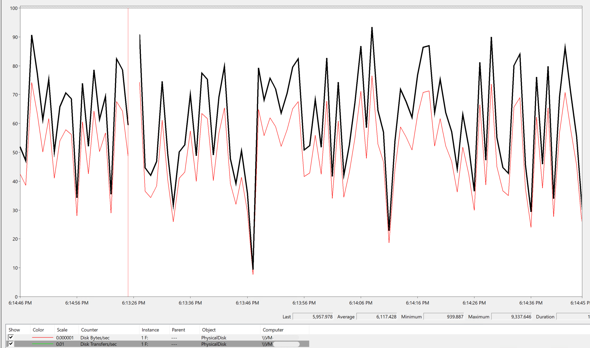
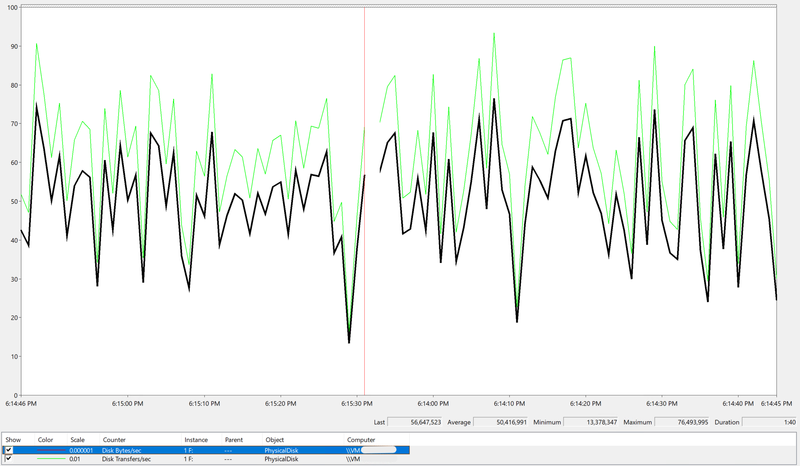
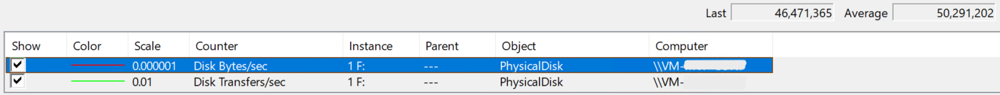
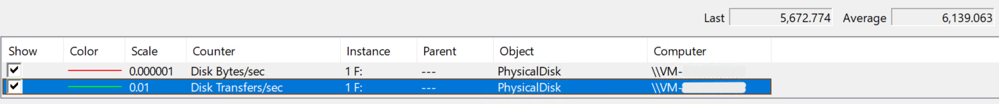

A DBA doesn't need to be a storage specialist. But we do need to know where the bottleneck is, because "the database is slow" usually lands on our desk first, and "let's buy a bigger disk" is often the first answer someone proposes.

Before we start, a disclaimer: I'm not a storage person. Someone from that area could probably take this analysis several levels deeper. For our scenario, though, that isn't necessary. Everything we need is in a SQL Server query, two PerfMon counters and a bit of math.

## Table of contents

## The setup

The test ran on this environment:

| Component | Value |
| --- | --- |
| Azure VM | `Standard_E2ads_v7` |
| Operating system | Windows Server 2022 |
| Database | SQL Server 2022 Standard |
| Disk | Azure Premium SSD v2 (drive `F:`) |
| Disk size | 512 GiB |
| Provisioned IOPS | 6,000 |
| Provisioned throughput | 300 MB/s |



In this test, the VM wasn't the bottleneck, thanks to VM-level bursting. VM limits and bursting deserve their own post, so here we'll focus on the disk.

On paper, this looks like a comfortable disk: 6,000 operations per second and 300 MB/s. Let's see what a real query does with it.

## Running an I/O-heavy query

To force SQL Server to read from disk, we clean the buffer pool and run an aggregation over a large table. Two sessions run the same script at the same time.

```sql
-- Test only: disable read-ahead for the whole instance
DBCC TRACEON(652, -1);

-- Clean buffers/cache
CHECKPOINT;
DBCC DROPCLEANBUFFERS;

-- Query to stress the disk
SELECT
    SUM(SalesAmount),
    SUM(OrderQuantity),
    SUM(UnitPrice),
    SUM(TotalProductCost)
FROM AdventureWorksDW2022.dbo.FactResellerSalesXL_CCI_BIG -- Despite the name, this table is a heap (no columnstore)
OPTION (MAXDOP 2);
GO 10

-- When all sessions finish, run this once to turn read-ahead back on: DBCC TRACEOFF(652, -1);
```

> [!WARNING]
> Don't run `DBCC DROPCLEANBUFFERS` or trace flag 652 on a production server. The first empties the buffer pool, so every query has to go back to disk. The second disables read-ahead for the whole instance.

> [!NOTE]
> I disabled read-ahead with trace flag 652 on purpose. Read-ahead lets SQL Server read several pages in a single request. Without it, each read brings one 8 KiB page (8 KiB, not 8 KB, as I explained [in this LinkedIn post](https://lnkd.in/p/drjaW-BZ)). In a normal workload, the average I/O size would be different.



While the query runs, the sessions are waiting on `PAGEIOLATCH_SH`, which means they're waiting for data pages to be read from disk into memory.



So far, nothing surprising. A query that reads a lot from disk is waiting on disk.

## What PerfMon shows

I added two counters for the `F:` drive (`PhysicalDisk`), with a 1-second sample interval:

- `Disk Transfers/sec`: read and write operations per second. This is our IOPS.
- `Disk Bytes/sec`: bytes read and written per second. This is our throughput.





The charts were captured at different moments of the test. Averages for a single window:

| Counter | Average |
| --- | ---: |
| `Disk Transfers/sec` | 6,139.063 |
| `Disk Bytes/sec` | 50,291,202 |





About 6,100 operations per second, right around the 6,000 IOPS we provisioned. And about 50 MB/s of throughput.

Now the natural reaction: "We're using only 50 MB/s out of 300. The disk has plenty of room left, so the problem must be somewhere else, right?"

Wrong!

## The missing variable: I/O size

IOPS tells us how many operations happen per second. Throughput tells us how much data moves per second. What connects the two is the size of each operation.

```text
Throughput (bytes/s) = IOPS × average I/O size (bytes)
```

If we know two of these values, we can find the third. PerfMon gave us IOPS and throughput, so let's find the average I/O size:

```text
50,291,202 bytes/s ÷ 6,139.063 operations/s = 8,192 bytes per operation
```

8,192 bytes is exactly 8 KiB: one SQL Server page per read, as expected with read-ahead disabled.

Now the question that proves the title: with 8 KiB per operation, how many IOPS would we need to use the 300 MB/s we're paying for?

```text
300,000,000 bytes/s ÷ 8,192 bytes = 36,621 IOPS
```

We'd need more than 36,000 IOPS, six times what the disk provides. With this workload, the disk will hit its 6,000 IOPS limit long before it gets anywhere near 300 MB/s. We're paying for throughput we can't use, which means we're spending money on capacity that brings no benefit to this workload.

If you can't identify the bottleneck, you might keep increasing throughput without making any difference. The same applies in reverse: increasing IOPS won't help if throughput is the limiting factor.

You may have noticed in the PerfMon charts that the two lines move together almost all the time. That's the formula drawn on screen: when the I/O size stays constant, bytes per second follows operations per second.

## IOPS, throughput and I/O size, side by side

Let's put the concepts next to each other.

- **IOPS** (Input/Output Operations Per Second): how many read or write operations the storage completes per second.
- **Throughput**: how many bytes are transferred per second, usually shown in MB/s.
- **Average I/O size**: how many bytes each operation transfers, on average. It depends on the workload, not on the disk.

One detail that's easy to get wrong: Azure uses decimal megabytes, so 1 MB/s = 1,000,000 bytes per second. Windows tools often show binary units, where 1 MiB = 1,048,576 bytes. Our 50,291,202 bytes/s is 50.3 MB/s or 48.0 MiB/s, depending on which unit you use. When you compare numbers from different tools, check the unit first.

Here's what the same 6,000 IOPS means in throughput for different I/O sizes:

| Average I/O size | Theoretical throughput at 6,000 IOPS |
| --- | ---: |
| 4 KiB | 24.6 MB/s |
| 8 KiB | 49.2 MB/s |
| 16 KiB | 98.3 MB/s |
| 32 KiB | 196.6 MB/s |
| 64 KiB | 393.2 MB/s (capped at the disk's 300 MB/s) |

These are calculated values, not measurements. They show the upper bound the disk's IOPS allows for each I/O size.

The same table also tells us where this disk changes from one limit to the other:

```text
300,000,000 bytes/s ÷ 6,000 IOPS = 50,000 bytes (about 48.8 KiB)
```

With an average I/O size below about 48.8 KiB, this disk runs out of IOPS before it runs out of throughput. Above that size, throughput becomes the limit. Our workload, at 8 KiB, is far into IOPS territory.

## Practical takeaways

So, is your disk provisioned wrong? If it was sized by looking only at IOPS, or only at throughput, there's a good chance. Here's what I'd look at before choosing or resizing a disk:

1. **Measure your average I/O size before you provision.** Divide `Disk Bytes/sec` by `Disk Transfers/sec`, or use `Avg. Disk Bytes/Read` and `Avg. Disk Bytes/Write` directly. If you're on AWS, each EBS volume's **Monitoring** tab already shows the *Average read/write size* graphs, built from CloudWatch metrics.
2. **Size for peaks and maintenance, not for an average day.** Business peaks, index rebuilds, `DBCC CHECKDB`, backups and ETL loads can change both the number of operations and their size. You may need additional IOPS or throughput to handle these scenarios, so measure performance during those windows too.
3. **Data files and log files behave differently.** Data files usually mix small random reads with larger scans. The transaction log, on the other hand, is written sequentially, with I/O sizes varying depending on the workload. These different access patterns may call for different disk configurations.
4. **Reads and writes have different average sizes.** Measure them separately. A disk sized for the read pattern may be wrong for the write pattern, and the other way around.
5. **An average hides the distribution.** An 8 KiB average can be a mix of very small and very large requests. Look at how the values change over time, not just a single number.
6. **Don't pay for throughput you can't use.** On Premium SSD v2, the first 3,000 IOPS and 125 MB/s are free, and you pay for what you provision above that. At 8 KiB, 6,000 IOPS uses about 49 MB/s, well below the free 125 MB/s. In this scenario, everything provisioned between 125 and 300 MB/s only adds cost.
7. **Sometimes the fix isn't storage.** Compression, columnstore and better indexes reduce how many bytes a query needs to read. Tuning can lower the I/O before you change the disk.
8. **Sometimes the answer is more memory.** The more data fits in the buffer pool, the fewer pages SQL Server has to read from disk. If the same pages keep being read again and again, adding memory can cut those reads without touching the disk at all.
9. **Latency is what users feel.** IOPS and MB/s describe capacity. `Avg. Disk sec/Read` and `PAGEIOLATCH_*` waits show whether the workload is actually suffering.

IOPS alone doesn't describe a disk. Neither does throughput. Once we know the average I/O size, the two numbers start to make sense together, and we can provision for the workload we really have.

The problem is that most disks are provisioned without taking any of this into account. And that's why your disk is ~~probably~~ provisioned wrong.

## References

- [Pages and extents architecture guide](https://learn.microsoft.com/en-us/sql/relational-databases/pages-and-extents-architecture-guide)
- [Read data pages in the Database Engine (read-ahead)](https://learn.microsoft.com/en-us/sql/relational-databases/reading-pages)
- [DBCC TRACEON - Trace flags (trace flag 652)](https://learn.microsoft.com/en-us/sql/t-sql/database-console-commands/dbcc-traceon-trace-flags-transact-sql)
- [sys.dm_io_virtual_file_stats](https://learn.microsoft.com/en-us/sql/relational-databases/system-dynamic-management-views/sys-dm-io-virtual-file-stats-transact-sql)
- [Azure managed disk types (Premium SSD v2)](https://learn.microsoft.com/en-us/azure/virtual-machines/disks-types)
- [Eadsv7 series sizes](https://learn.microsoft.com/en-us/azure/virtual-machines/sizes/memory-optimized/eadsv7-series)
- [Virtual machine and disk performance](https://learn.microsoft.com/en-us/azure/virtual-machines/disks-performance)
- [Amazon CloudWatch metrics for Amazon EBS](https://docs.aws.amazon.com/ebs/latest/userguide/using_cloudwatch_ebs.html)
